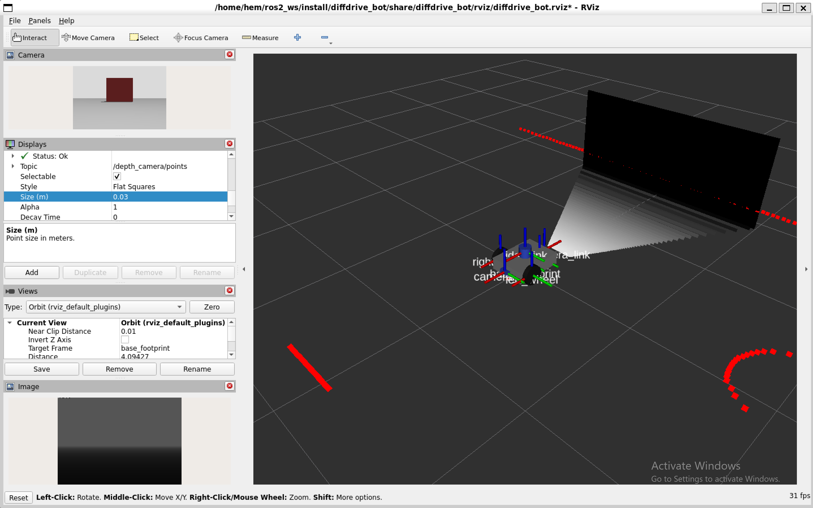
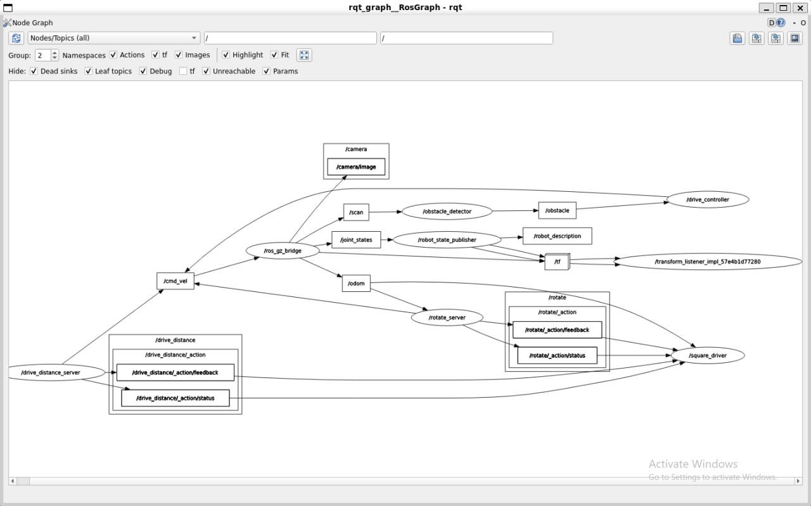

# Lab 1 Exercise: Program diffdrive_bot

Author: Hemen Solomon

This folder holds my solution to the Lab 1 exercise of Introduction to Robotics and Intelligent
Systems. It has four packages:

| Package | Contents |
|---------|----------|
| `diffdrive_bot` | the lab robot, extended with a depth camera and an IMU |
| `lab_interfaces` | the lab's message, service and action types |
| `my_robot_interfaces` | my own `RobotStatus.msg`, `SetTurnSpeed.srv` and `Rotate.action` |
| `my_robot_nodes` | my nodes `turn_away`, `rotate_server`, `square_driver` and `square.launch.py` |

## Requirements

Ubuntu 22.04 (I used WSL 2), ROS 2 Humble, and Gazebo Harmonic with `ros-humble-ros-gzharmonic`,
plus `ros-humble-xacro`, `ros-humble-joint-state-publisher-gui` and `ros-humble-teleop-twist-keyboard`.

## Build

```bash
source /opt/ros/humble/setup.bash
mkdir -p ~/ros2_ws/src && cd ~/ros2_ws/src
git clone https://github.com/hemen-30/lab1_exercise.git
cd ~/ros2_ws
colcon build --symlink-install
source install/setup.bash
```

Every new terminal needs `source /opt/ros/humble/setup.bash` and
`source ~/ros2_ws/install/setup.bash`. Stop a run with Ctrl+C in the launch terminal, then
`pkill -f "gz sim"` if a Gazebo process stays alive.

## Step 1: depth camera and IMU

Changed files in `diffdrive_bot`: `urdf/diffdrive_bot.urdf.xacro` (links `depth_camera_link` and
`imu_link`, their joints and Gazebo sensors), `worlds/obstacles.sdf` (the IMU system) and
`config/bridge.yaml` (four new bridged topics).

```bash
ros2 launch diffdrive_bot display.launch.py
ros2 run tf2_ros tf2_echo base_link depth_camera_link
ros2 launch diffdrive_bot gazebo.launch.py
ros2 topic hz /imu
ros2 topic echo /imu --once
```

Results: `tf2_echo` showed the depth camera at (-0.215, 0, 0) turned 180 degrees about z.
With the robot standing still, `linear_acceleration.z` was 9.80 and `angular_velocity.z` was about 0.
While it turned, `angular_velocity.z` was 1.13 rad/s.



## Steps 2 to 5: the `turn_away` node

Start the robot and nodes in one terminal and my node in a second one. Do not switch on
`/drive_enable` or send `/drive_distance` goals while my nodes drive.

```bash
ros2 launch diffdrive_bot control.launch.py
ros2 run my_robot_nodes turn_away
```

- Step 2: drives forward at 0.2 m/s, and turns on the spot at 0.5 rad/s away from an obstacle
  that is too close (right if `angle` is positive, left otherwise).
- Step 3: `forward_speed` and `turn_speed` are parameters, read on every message.
  `ros2 param set /turn_away forward_speed 0.4` made the robot drive faster.
- Step 4: publishes `my_robot_interfaces/msg/RobotStatus` on `/robot_status`
  (`ros2 interface show my_robot_interfaces/msg/RobotStatus`, `ros2 topic echo /robot_status`).
  The state changed from `turning` to `forward` as the obstacle distance passed 0.5 m.
- Step 5: the node starts switched off (state `stopped`).

```bash
ros2 service call /turn_away_enable std_srvs/srv/SetBool "{data: true}"
ros2 service call /set_turn_speed my_robot_interfaces/srv/SetTurnSpeed "{turn_speed: 1.0}"
ros2 service call /set_turn_speed my_robot_interfaces/srv/SetTurnSpeed "{turn_speed: 3.0}"
ros2 service call /turn_away_enable std_srvs/srv/SetBool "{data: false}"
```

A speed of 1.0 was accepted ("turn speed set to 1.00 rad/s") and 3.0 was rejected ("turn speed must
be above 0 and at most 1.5 rad/s"). `ros2 param get /turn_away turn_speed` returned 1.0.

## Step 6: the `rotate_server` action server

Run only `rotate_server`, not `turn_away`, because both publish to `/cmd_vel`.

```bash
ros2 launch diffdrive_bot control.launch.py
ros2 run my_robot_nodes rotate_server
ros2 action send_goal --feedback /rotate my_robot_interfaces/action/Rotate "{angle: 1.57}"
ros2 run tf2_ros tf2_echo odom base_link
```

The goal succeeded with a result of 1.588 rad, and `tf2_echo` showed a heading of 91.6 degrees.
A goal of 0.0 was rejected. A goal of 6.28 turned 6.29 rad. The server adds up the small change in
yaw between odometry messages, so the jump from pi to -pi does not matter.

## Step 7: the square

One command starts the simulation, the lab nodes, `rotate_server` and `square_driver`:

```bash
ros2 launch my_robot_nodes square.launch.py side_length:=0.8
```

`square_driver` waits for both action servers and the first odometry message. Four times it sends
a `DriveDistance` goal of `side_length` and then a `Rotate` goal of a quarter turn to the left,
waiting for each result. If a goal does not succeed it logs the side and stops.

The robot completed all four sides, each about 0.80 to 0.81 m, and the log ended with
"Square finished".



## What did not work, and why I think so

- **The simulation is slow.** Gazebo showed a real-time factor of about 29 % on WSL 2. The IMU
  should publish at 50 Hz, but `ros2 topic hz /imu` showed about 9 Hz. The smallest gap between
  messages was 0.020 s, which is 50 Hz in simulation time, so I think the sensor is set up
  correctly and the computer cannot keep up. The square took several minutes for the same reason.
- **The depth image was black in RViz at first.** The point cloud on `/depth_camera/points` showed the
  floor and the wall, so the sensor worked. I think the depth values were being scaled badly.
  Unticking Normalize Range and setting Min 0 and Max 5 showed the floor and the wall as grey.
  When the robot faced away from the wall, the top half of the image was white because nothing
  was in range.
- **`/imu` and `/depth_camera/...` were missing in ROS at first.** Gazebo published
  `/depth_camera` but ROS did not see it, because I had edited the URDF but not yet
  `bridge.yaml` or the IMU line in `obstacles.sdf`. After adding them and restarting, all four
  topics appeared. A bridge reads its configuration only at start-up.
- **Closing the Gazebo window shut down everything.** The launch file treats the Gazebo window as
  required. The Gazebo server also exited with code -11 while being killed, which I think is a
  crash during shutdown on WSL, and it did not affect later runs.
- **The turns overshoot a little.** A 1.57 rad turn gave 1.588 rad, and a 6.28 rad turn gave
  6.29 rad. I think this is because the server checks the angle only about every 0.05 s while the
  simulation lags, so the robot turns slightly past the goal before it stops.
- **Gazebo printed "gz_frame_id ... not defined in SDF" warnings** for the lidar and my two new
  sensors. The sensors worked, so I left them.
